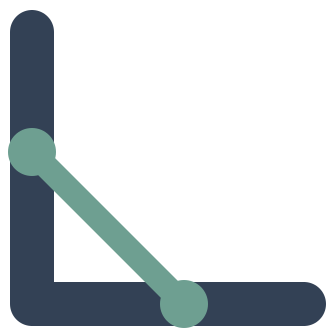
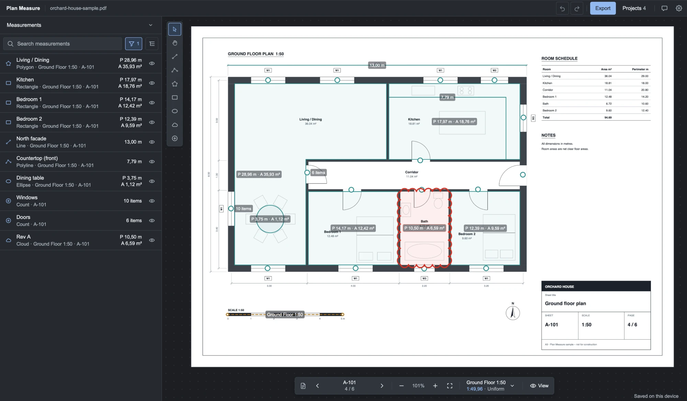

<div align="center">



# Plan Measure

[](https://userfypp.github.io/plan-measure/)
[](https://userfypp.github.io/plan-measure/?sample=1)
[](https://github.com/userfypp/plan-measure/actions/workflows/ci.yml)
[](LICENSE)
[](https://github.com/userfypp/plan-measure/releases)

</div>

Measure distances, perimeters, and areas on architectural PDF plans, then export takeoff totals. Free and MIT licensed, with no account or install: it runs in your browser and plans are never uploaded. Missing something? [Open an issue](https://github.com/userfypp/plan-measure/issues/new/choose).



## Features

- Calibrate each page with a reference distance, separate X/Y scales, or a known ratio.
- Draw and edit lines, polylines, and polygons with Snap, Ortho, and undo/redo.
- Organize measurements with classifications, groups, notes, and reusable templates.
- Review totals across pages in Takeoff.
- Export CSV, XLSX, ODS, JSON, annotated PDFs, or editable project backups.

## Quick start

1. Choose **Open PDF** or drop a PDF into the workspace, or **Try a sample**.
2. In **Scales → Add scale**, mark a known distance and enter its real-world length.
3. Choose **Line**, **Polyline**, or **Polygon**, click to place points, and press `Enter` to finish.
4. Open **Takeoff** for totals or **Export** to download results.

See the [user guide](docs/user-guide.md) for scales, editing, exports, recovery, and keyboard controls.

## Storage and limits

Projects autosave in this browser, with no cloud sync; clearing site data removes them. Use **Export backup** (save status) or **Projects → Export** to keep a `.planmeasure` backup with the PDF and editable data. JSON and spreadsheet exports are not backups.

- PDFs up to 100 MiB (104.9 MB); password-protected PDFs cannot be opened.
- Drawing needs at least 480 × 360 px of viewer space and a fine pointer, or keyboard authoring enabled in Settings.
- X/Y calibration corrects axis scale differences, not skew or perspective.
- Offline use depends on the browser cache; it is not yet an installable PWA.

## Development

Requires Node.js 24:

```bash
npm ci
npm run dev
```

[Contributing](CONTRIBUTING.md) · [Credits](CREDITS.md) · [Roadmap](docs/ROADMAP.md) · [Releasing](docs/RELEASING.md) · [JSON export contract](docs/export-json.md) · [Changelog](CHANGELOG.md) · [Security](SECURITY.md) · [Code of conduct](CODE_OF_CONDUCT.md)
