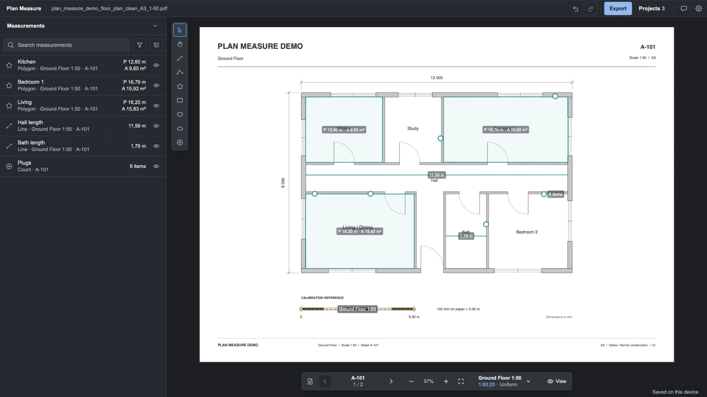

<div align="center">


# Plan Measure

[](https://userfypp.github.io/plan-measure/)
[](https://userfypp.github.io/plan-measure/?sample=1)
[](https://github.com/userfypp/plan-measure/actions/workflows/ci.yml)
[](LICENSE)
[](https://github.com/userfypp/plan-measure/releases)

</div>

Measure distances, perimeters, and areas on architectural PDF plans, then export takeoff totals. Missing something? [Open an issue](https://github.com/userfypp/plan-measure/issues/new/choose). I usually reply within a day.



## Why Plan Measure

| | Plan Measure | Typical desktop takeoff suites (Bluebeam, PlanSwift, On-Screen Takeoff) |
|---|---|---|
| Price | Free, MIT licensed | Paid license or subscription |
| Account | None | Usually required |
| Install | None, runs in the browser | Desktop installer |
| Privacy | Plans processed locally, never uploaded | Varies; some features use cloud services |
| Offline | Works after the first load\* | Yes |

\*Plan Measure is not yet an installable PWA; offline use depends on the browser cache.

## What you can do

- Calibrate each page with a reference distance, separate X/Y scales, or a known ratio.
- Draw and edit lines, polylines, and polygons with Snap, Ortho, and undo/redo.
- Organize measurements with classifications, groups, notes, and reusable templates.
- Review totals across pages in Takeoff.
- Export CSV, XLSX, ODS, JSON, annotated PDFs, or editable project backups.

## Quick start

1. Choose **Open PDF** or drop a PDF into the workspace. Use **Try a sample** to explore a prepared project.
2. In **Scales**, choose **Add scale → Uniform**, mark a known distance, and enter its real-world length. Use **Custom ratio** if you know the plan's scale.
3. Choose **Line**, **Polyline**, or **Polygon** and click to place points. Press `Enter` to finish a Polyline or Polygon.
4. Use **Select** to edit a measurement and **Details** to name or classify it.
5. Open **Takeoff** for totals or **Export** to download results.

See the [user guide](docs/user-guide.md) for scales, editing, exports, recovery, and keyboard controls.

## Storage and limits

PDFs and measurements are processed in your browser and are not sent to a server. Projects autosave on this device; there is no cloud sync.

**Use the save status → Export backup or Projects → Export to keep a `.planmeasure` backup**, including the PDF and editable data. Persistent browser storage is requested after a confirmed save when supported; clearing site data still removes saved projects. JSON and spreadsheet exports are not editable project backups.

- PDF size limit: 100 MB. PDFs that require a password cannot be opened.
- Drawing and geometry editing need at least 480 × 360 px of unobscured viewer space and a fine pointer or keyboard authoring enabled in Settings.
- X/Y calibration corrects axis scale differences, not skew or perspective.

## Development and project docs

Requires Node.js 24 and npm:

```bash
npm ci
npm run dev
```

- [Contributing](CONTRIBUTING.md): checks, issues, and pull requests.
- [Roadmap](ROADMAP.md): planned work and priorities.
- [Releasing](RELEASING.md): release process and maintainer operations.
- [JSON export contract](docs/export-json.md): schema for integrations.
- [Changelog](CHANGELOG.md): release history.
- [Security policy](SECURITY.md) · [Code of conduct](CODE_OF_CONDUCT.md).
